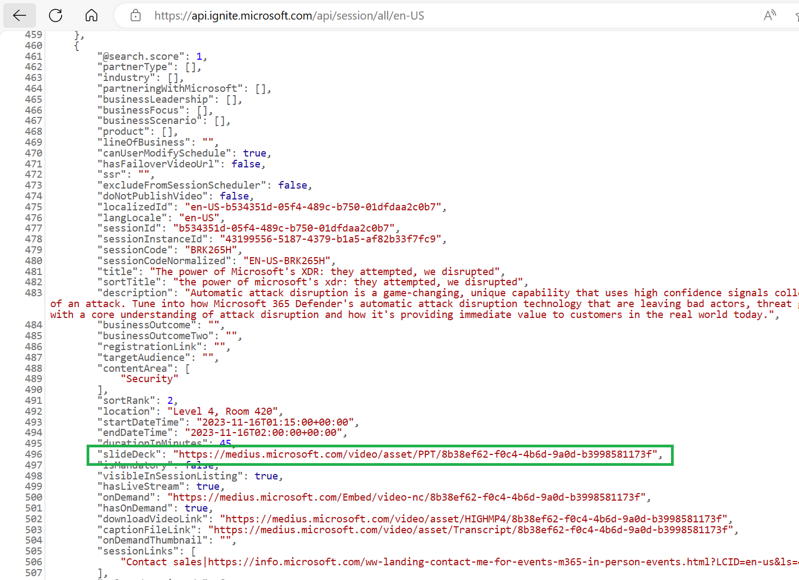

# Microsoft Flagship Event Deck Download
Simple script to download decks from flagship event [Microsoft Ignite](https://ignite.microsoft.com/en-US/home) or [Microsoft Build](https://build.microsoft.com/en-US/home) sessions.<br><br>

The APIs for getting session details may be a bit different for each event in different years, so old script may need to be adjusted accordingly.
<br><br>


## Script files
- [Microsoft Build 2026](/MSBuild2026-Download-Resources.ps1) — parallel downloads, requires PowerShell 7+
- [Microsoft Ignite 2025](/MSIgnite2025-Download-Resources.ps1)


## Usage

Download all decks
```
./<event script file>.ps1
```
Download specific session decks
```
./<event script file>.ps1 -sessionCodes "BRK403,BRK404"
```

### Build 2026 script (PowerShell 7+)
Downloads sessions in parallel for significantly faster completion. An optional `-throttleLimit` parameter controls the number of concurrent downloads (default: 5).
```
./MSBuild2026-Download-Resources.ps1
./MSBuild2026-Download-Resources.ps1 -sessionCodes "BRK403,BRK404"
./MSBuild2026-Download-Resources.ps1 -throttleLimit 8
```
Check your PowerShell version with `$PSVersionTable.PSVersion`. If below 7, upgrade or use an archived script as a base.

## Archived scripts
Older scripts are kept in the [archived](/archived/) folder for reference.
- [Microsoft Build 2025](/archived/MSBuild2025-Download-Resources.ps1)
- [Microsoft Ignite 2024](/archived/MSIgnite2024-Download-Resources.ps1)
- [Microsoft Ignite 2023](/archived/MSIgnite2023-Download-Resources.ps1)

Session Deck download link can be found in key _slideDeck_

<br>

